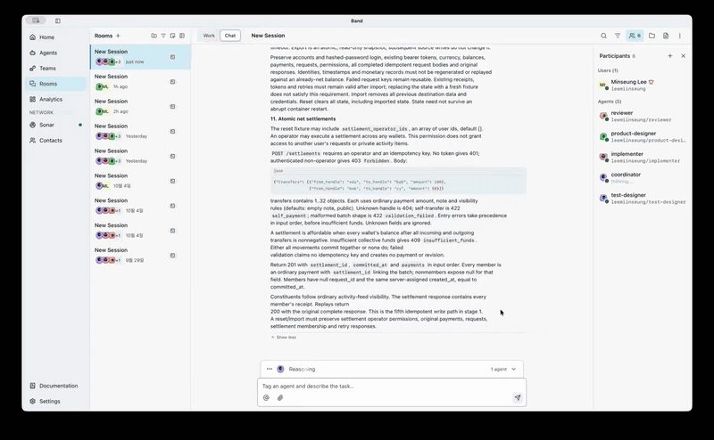
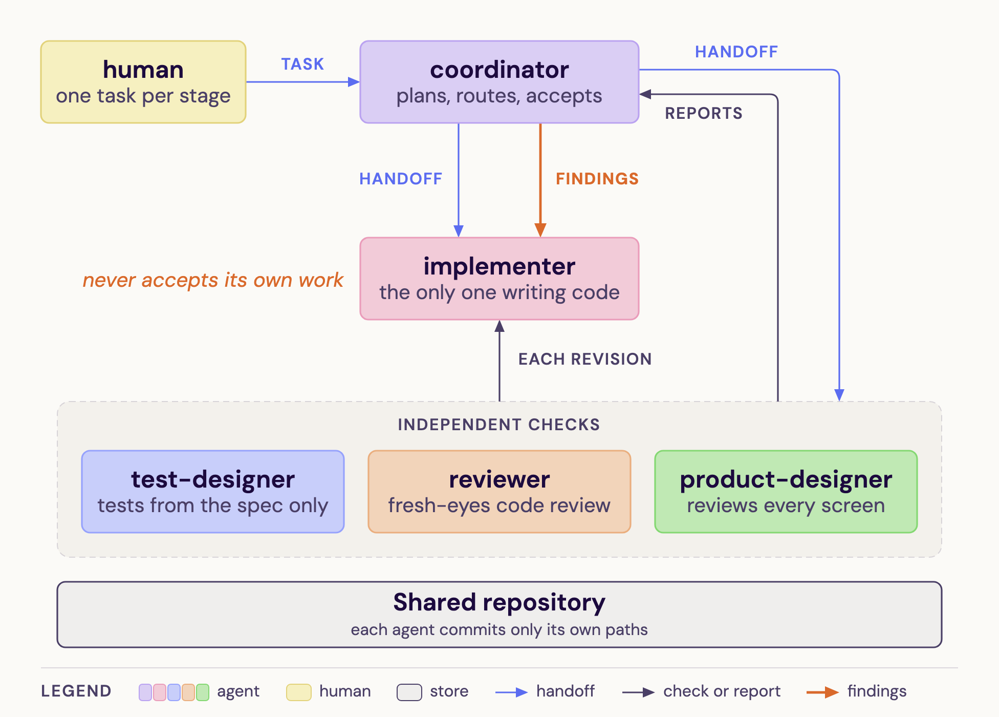
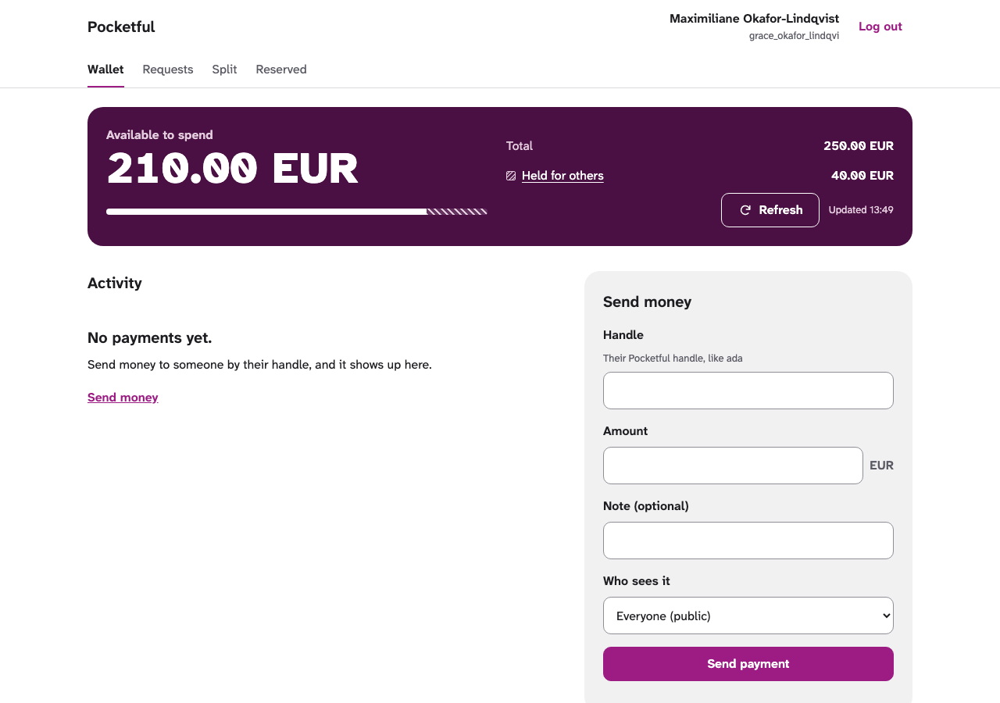
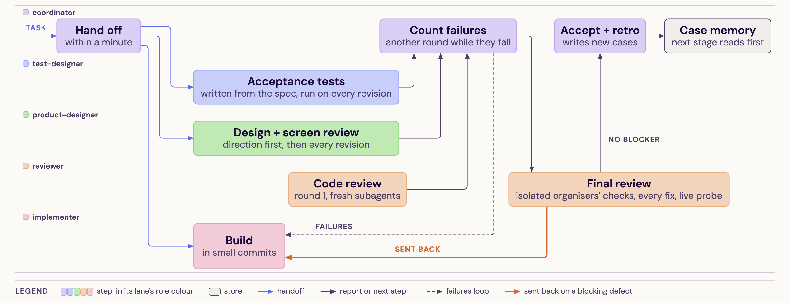

# Pocketful, built by a five-agent software factory

Five AI coding agents built a payments wallet service in four stages. The only human input
was one task message per stage. I designed this agent "factory" and ran it, solo, for the
WeAreDevelopers × BAND "Dark Factory" hackathon (September to October 2026).

*The agents' shared room, sped up. It shows the first 3.5 hours of the 10-hour run.
[60-second version](docs/room-timelapse-60s.mp4)*

## Results

| | This factory | Organisers' minimal setup (3 agents) |
|---|---|---|
| Stages passing the organisers' checks | **4 of 4** | 4 of 4 |
| Human messages during a stage | **0** | 0 |
| Blocking issues caught and fixed before acceptance | **31** | 1 |
| Commits by agents (by agents other than the coder) | **262 (123)** | 6 |
| Time | 9 h 59 min | 2 h 2 min |
| Model cost, API-price equivalent | $207 | $38 |

The extra time and cost buy review. Every stage was sent back and fixed before it was
accepted. The organisers' checks are a published sample of their grading tests.

## How it works

- **One role each.** The coordinator plans and accepts. Only the implementer writes product
  code. A test designer, a code reviewer and a product designer check every revision.
- **The builder never judges itself.** Hooks, small scripts that run before every agent
  action, stop the implementer from editing the tests or reviews that judge it.
- **No human help.** Agents cannot ask the human anything, and git history can only grow.
- **Generic.** The instructions never name the product, so the same factory can take on
  another problem.

The product is a payments wallet (no crypto) written in Node.js with no third-party packages.
It handles payments, requests, splits, holds, corrections and refunds.

## My role

I designed the factory: the roles and their instructions, the hooks, and the skills the
agents load. Then I ran it and measured the results. Everything under `stage-1/` to
`stage-4/` and `work/` was written by the agents.

<b>How one stage runs</b>

1. The coordinator hands the stage to the other four agents within a minute.
2. The test designer writes acceptance tests from the specification. The product designer
   sets a design direction. The implementer builds in small commits.
3. After each round, the coordinator counts the failures. Another round runs only while
   that count falls.
4. The reviewer's final review runs the organisers' checks offline, reviews every fix and
   tries the running app. A blocking defect sends the stage back.
5. The coordinator accepts and writes down new lessons, which the next stage reads first.

<b>What is in this repository</b>

| Path | What it holds |
|---|---|
| `stage-1/` to `stage-4/` | The service at each stage. Each folder builds and runs by its own `RUN.md` and still passes every earlier stage. |
| `mandates/` | One instruction file per agent. |
| `FACTORY.md` | How the factory works and why, how to set it up, what it cost, how it catches bad work, and what failed. |
| `room.json` | The full log of the agents' room, unedited (6,001 messages). |
| `work/` | The agents' own records: requirement lists, tests, design direction, reviews and decisions. |
| `seat-config/` | Agent launchers, hooks, skills, and the scripts that create the agents and start a run. |
| `docs/` | The images and video on this page. |

<b>Where to read further</b>

1. `FACTORY.md` explains the design in full.
2. `work/stage-N/decisions.md` holds each stage's plan, one line per checking round, and the
   acceptance.
3. `work/reviews/` holds every review report, and `work/reviews/screens/` the screenshots of
   each accepted version.
4. Commits name the requirement ids discussed in `room.json`, so any change can be traced from
   the conversation to the code.

Each `stage-N/RUN.md` gives the commands to run that stage. The service runs in a container
with no network access.

